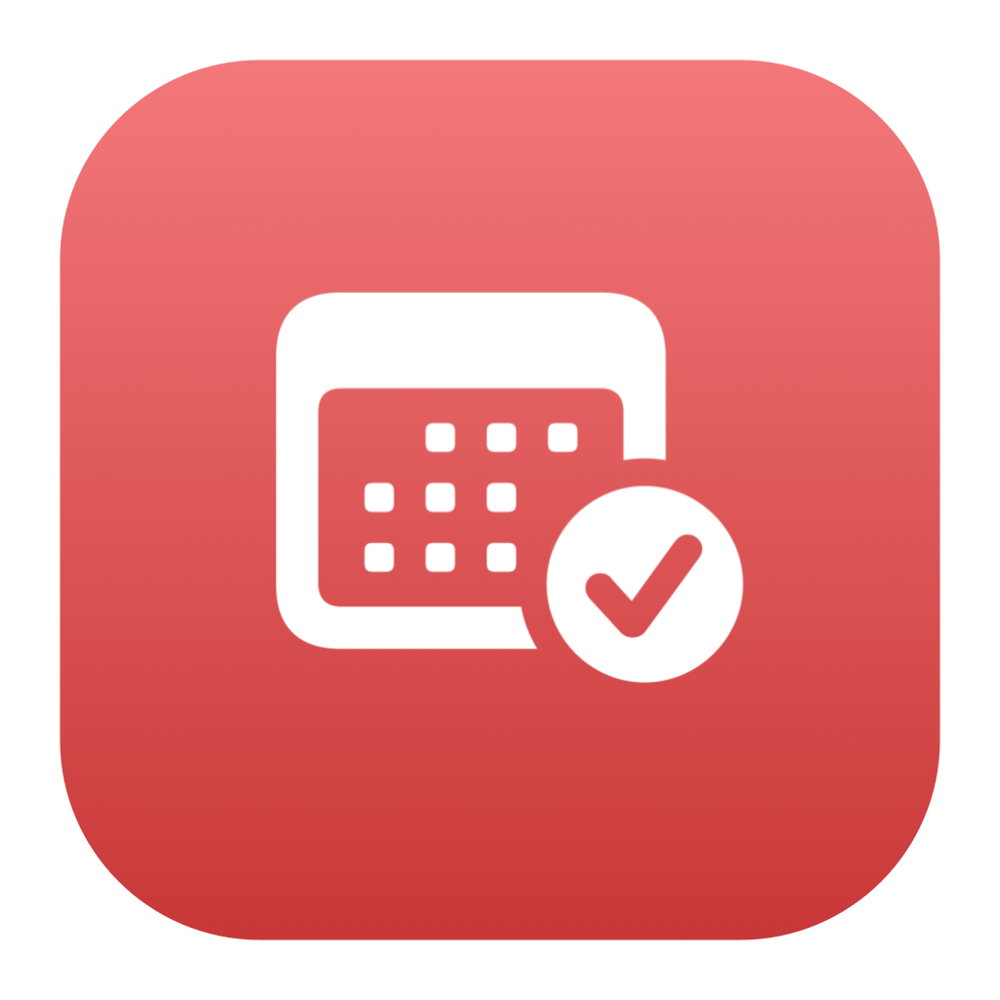
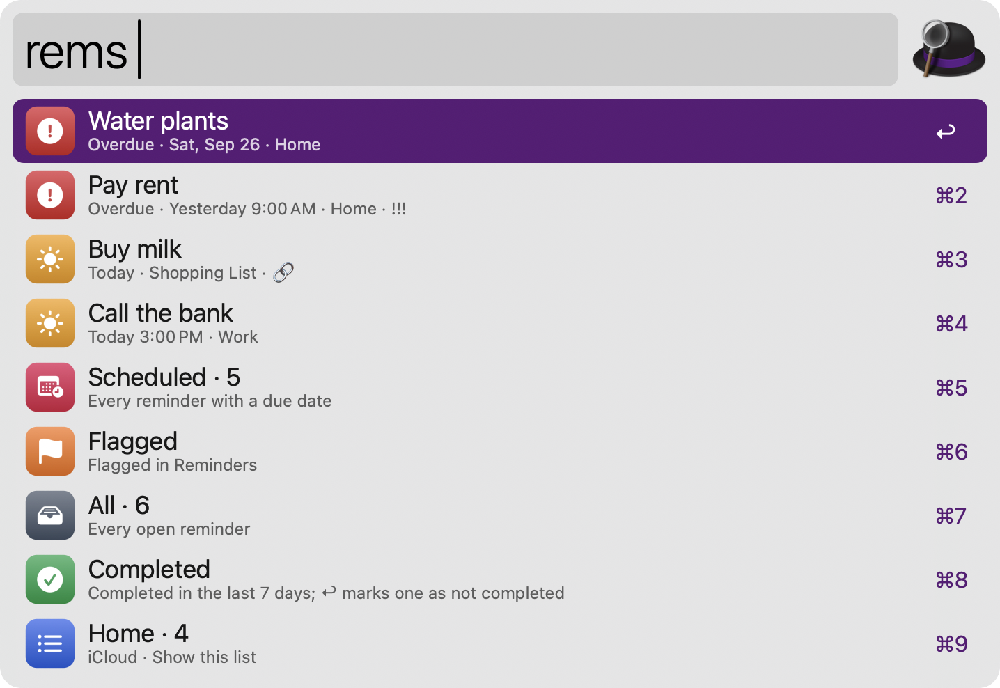
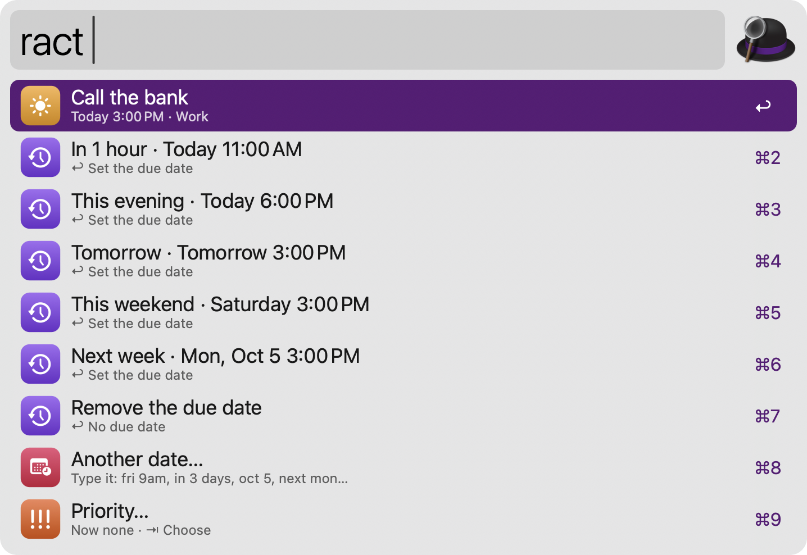
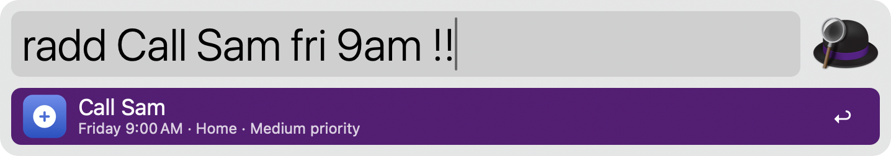
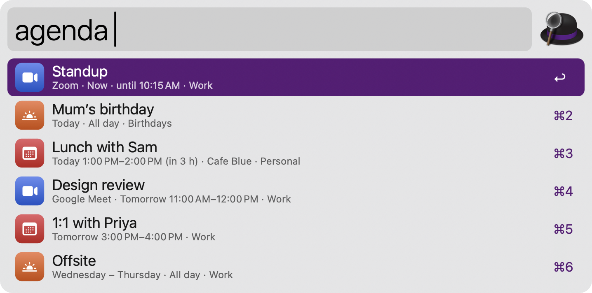
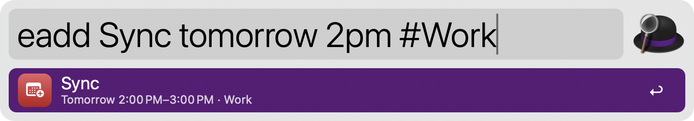
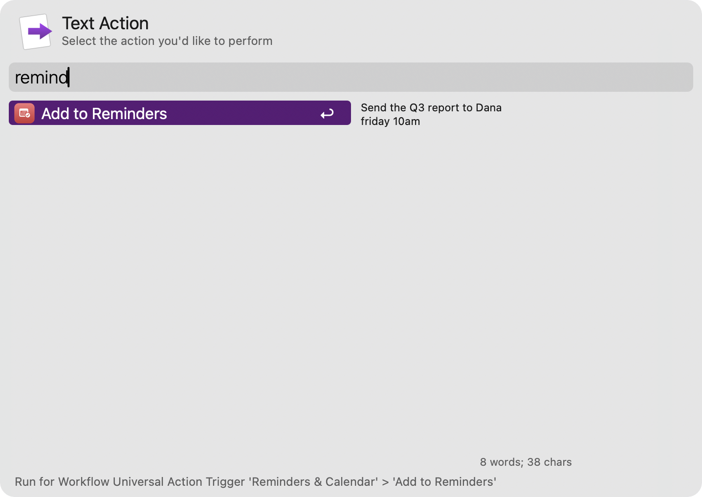

#  Reminders & Calendar

Add reminders and events in plain English, see what’s due today, complete, snooze and delete reminders, and join your next meeting, all through EventKit, without opening Reminders or Calendar.

## Usage

See what’s due today via the `rems` keyword: overdue reminders first, then today’s, followed by the Scheduled, Flagged, All and Completed views and your lists. Type to search every open reminder by title, notes and list. Type `:` for the views (`:today`, `:overdue`, `:scheduled`, `:flagged`, `:all`, `:done`) and `#` for a list, like `rems #Home milk`.



* <kbd>↩</kbd> Complete the reminder. A row at the top of `rems` undoes it for 10 minutes.
* <kbd>⌘</kbd><kbd>↩</kbd> Open the reminder in Reminders.
* <kbd>⌥</kbd><kbd>↩</kbd> Change its due date, priority or list.
* <kbd>⌃</kbd><kbd>↩</kbd> Delete it (asks first).
* <kbd>fn</kbd><kbd>↩</kbd> Open the link in the reminder.
* <kbd>⌘</kbd><kbd>C</kbd> Copy the title.
* <kbd>⌘</kbd><kbd>L</kbd> Show the reminder and its notes in Large Type.

In the Completed view, <kbd>↩</kbd> marks a reminder as not completed.

Snooze a reminder or change its due date via the `ract` keyword, which <kbd>⌥</kbd><kbd>↩</kbd> opens with the reminder chosen: pick In 1 hour, This evening, Tomorrow, This weekend or Next week, or type any date, like `fri 9am` or `in 3 days`. A date without a time keeps the reminder’s time. Type `!high` to change the priority, `#List` to move it, or `delete` to delete it.



Add a reminder via the `radd` keyword, like `pay rent fri 9am !high #Home`. The preview shows exactly what will be saved.



* Dates: `today`, `tomorrow`, `tonight`, weekday names (`fri` is the next Friday, `next fri` the one in the following week), `this weekend`, `next week`, `next month`, `in 3 days`, `in 2 hours`, `oct 5`, `5 oct 2027`, `5/10` (in your region’s order), `2026-10-05`.
* Times: `5pm`, `5:30 pm`, `17:30`, `noon`, `morning`, `at 9`, and a time zone after the time, like `3pm UTC`, `9am ET` or `15:00 Europe/London`. A time that has passed today means tomorrow.
* Repeats: `every day`, `every weekday`, `every 2 weeks`, `every mon and thu`, `monthly`.
* Priority `!`, `!!`, `!!!` or `!low`, `!medium`, `!high`; list `#Home` or `#"Shopping List"`; a link anywhere; notes after `//`. Words in "quotes" are kept as typed.

* <kbd>↩</kbd> Add the reminder.
* <kbd>⌘</kbd><kbd>↩</kbd> Add it and open Reminders.
* <kbd>⌥</kbd><kbd>↩</kbd> Add the text exactly as typed, without a date.

A search in `rems` also offers to add what you typed as a reminder.

See today’s and upcoming events via the `agenda` keyword: what’s on now first, with “in 25 min” for the next few hours. Meetings with a Zoom, Google Meet, Teams, Webex or FaceTime link show the service. Type to search, or type a date, like `agenda fri`, to see that day. Type `:calendars` to choose which calendars show.



* <kbd>↩</kbd> Join the meeting, or open the event in Calendar when it has no link.
* <kbd>⌘</kbd><kbd>↩</kbd> Open the event in Calendar (or join, when <kbd>↩</kbd> opens).
* <kbd>⌥</kbd><kbd>↩</kbd> Copy the meeting link, or the event’s details.
* <kbd>⌘</kbd><kbd>L</kbd> Show the event’s details in Large Type.

Add an event via the `eadd` keyword, like `lunch with Sam tomorrow 1pm for 1h at Cafe`. Dates and times work as for reminders, plus `1-2pm`, `from 1pm to 3pm`, `until 5pm`, `for 90 min`, `for 3 days`, `all day`, a location after `at` or `@` (use `@"Joe’s Place"` for several words anywhere), `#Calendar`, a meeting link and `alert 10 min before`. The preview warns when the event overlaps another.



* <kbd>↩</kbd> Add the event. A row at the top of `agenda` removes it again for 10 minutes.
* <kbd>⌘</kbd><kbd>↩</kbd> Add it and open it in Calendar.

Alternatively, add selected text as a reminder or an event via the Universal Actions. The first line is parsed and the rest becomes the notes.



Configure the Hotkeys to show today’s reminders or the agenda.

The first time, the workflow asks macOS for access to your reminders or calendars: press <kbd>↩</kbd> and choose Allow in the dialog about Alfred. If access was turned off, <kbd>↩</kbd> opens the right page of Privacy & Security. The Flagged view reads flags from the Reminders app, so macOS also asks whether Alfred may control Reminders.

In the Workflow’s Configuration, choose the list for new reminders, a time for reminders with only a date, whether reminders with a time notify you, the calendar for new events, the default event length and alert, whether words after “at” are the location, how far ahead the agenda looks, and what <kbd>↩</kbd> does on a meeting.

## Development

```bash
swift tools/make_icons.swift tools/icons.json src   # regenerate icons
python3 tools/build.py --package                     # write src/info.plist and dist/*.alfredworkflow
python3 tests/test_reminders_calendar.py             # run the tests (a fake EventKit, never your data)
```

## AI disclosure

This workflow was developed with the help of Claude (Anthropic), an AI assistant. The code is reviewed and tested by the author.
